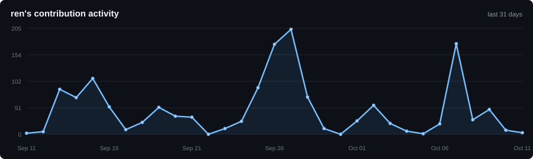
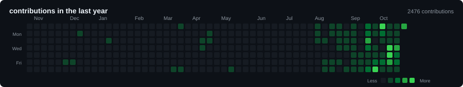

<h1 align="center">Dilan</h1>

  i dev using ai, for ideas to come to life and actually ship, roblox games, dev tools, and i also do research and data analysis

  undergrad student, but i do alot of stuff on the side and ai lets me go way faster on it, i don't just blindly do it though i make sure i understand the mechanism behind everything i do, helped me improve alot

  
  

---
### stack

### current

**[steal a car and race !](https://www.roblox.com/games/117024598464288)** : my own roblox driving game, live, built from scratch, map, cars, ui, gameplay, economy, the whole thing. strictly typed luau, 144 unit tests, lint and type checks on every change, profiled with the microprofiler and optimized, onboarding in 12 languages, and a release process that checks the live build matches the repo byte for byte

**roblox dev suite** : a full development suite for roblox i built for myself, reusable kit + tooling around studio, rojo, lune unit tests, ci gates, release and verification tools, studio automation, the game above is built on it

**live game analytics** : 11 months as a contractor at indigo, started as quality assurance for roblox games which expanded to bug fixes, shipping updates and data analysis etc, built my own analytics tool for it, collecting roblox creator Dashboard metrics, validating stored values against ground-truth exports, flagging unreliable readings, and comparing releases against normal d2d variation.

**[testhunch](https://github.com/amazing-source/testhunch)** : learns from CI history which tests a change is most likely to break and runs those first. on pypi, works with 6 test runners (pytest, vitest, jest, go, maven, cargo-nextest). successful in some ways, unsuccessful in some ways too, it kept a very rigorous process tho

**[research](https://github.com/amazing-source/strongly-regular-graphs-research)** : so that's what i'm focused on rn, i started research with my testhunch project, it really fascinated me so now i'm on conway's 99 graph problem, and so far so good, got some substantial results : a conway 99-graph, if it exists, has no symmetry at all. manuscripts are up on zenodo, two of the proofs formalised in lean 4, waiting on independent review and im hoping to publish them soon

### also built

**[ak auto](https://ak-auto-ten.vercel.app)** : site for a used car dealership near paris, next.js, tailwind, supabase, on vercel, with an end-to-end playwright suite

**guardian bot** : custom security bot for a discord server, discord.js + supabase, permanent bans that re-ban if anyone unbans, admin lockdown, auto-nuke on @everyone spam

**uni stuff** : a cyberbullying detector in C with mistral ai, and bot detection in the comment sections of media accounts on X

---
### activity

  

  

