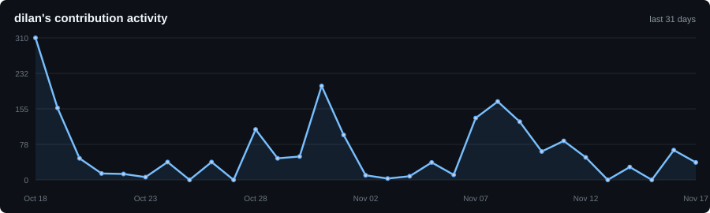
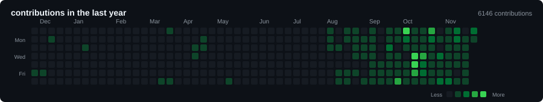

<h1 align="center">Dilan</h1>

software engineering, game dev, data analysis, research

  im a student, but i do alot of stuff on the side and ai lets me go way faster on it, i don't just blindly do it though i make sure i understand the mechanism behind everything i do, helped me improve alot, reason for my absurd amount of contributions is that i switch from device to device and it helps me keep track between sessions.

  
  

---
### stack

### current

**my own games** : i make roblox games solo, code, 3d models, animations, sound, ui, and then the analytics and ads behind them.

- **[steal a car and escape](https://www.roblox.com/games/117024598464288)** : my driving heist game, live. car physics for touch, keyboard and gamepad, guard chases, a car economy, 12 languages, and a voice-guided tutorial that took completion from 61% to 69% on its first day. strictly typed luau, 1,300+ unit tests and lint on every change, profiled and optimized with the microprofiler, and a release process that checks the live build matches the repo byte for byte
- **drive lab** : a realistic driving engine for roblox. tyre and suspension model, gearboxes, drift and stability control, first-person cockpits, every car tuned against its real published numbers (skidpad, braking, top speed). i prepared the cars in blender (a ferrari 458 challenge with working doors, wipers and gauges), animated the driver's hands and made the engine and road audio

**roblox dev suite** : a full development suite for roblox i built for myself, reusable kit + tooling around studio, rojo, lune unit tests, ci gates, release and verification tools, studio automation, the game above is built on it

**live game analytics** : 11 months as a contractor at indigo on live roblox games, started in qa and moved to bug fixes, shipping updates and data analysis, built my own analytics tool for it, collecting roblox creator Dashboard metrics, validating stored values against ground-truth exports, flagging unreliable readings, and comparing releases against normal d2d variation.

**[testhunch](https://github.com/amazing-source/testhunch)** : learns from CI history which tests a change is most likely to break and runs those first. on pypi, works with 6 test runners (pytest, vitest, jest, go, maven, cargo-nextest). successful in some ways, unsuccessful in some ways too, it kept a very rigorous process tho

**[research](https://github.com/amazing-source/strongly-regular-graphs-research)** : so that's what i'm focused on rn, i started research with my testhunch project, it really fascinated me so now i'm on conway's 99 graph problem, and so far so good, got some substantial results : a conway 99-graph, if it exists, has no symmetry at all. manuscripts are up on zenodo, two of the proofs formalised in lean 4, waiting on independent review and im hoping to publish them soon

### also built

**[ak auto](https://ak-auto-ten.vercel.app)** : site for a used car dealership near paris, next.js, tailwind, supabase, on vercel, with an end-to-end playwright suite

**guardian bot** : custom security bot for a discord server, discord.js + supabase, permanent bans that re-ban if anyone unbans, admin lockdown, auto-nuke on @everyone spam

**uni stuff** : a cyberbullying detector in C with mistral ai, and bot detection in the comment sections of media accounts on X

---
### activity

  

  

